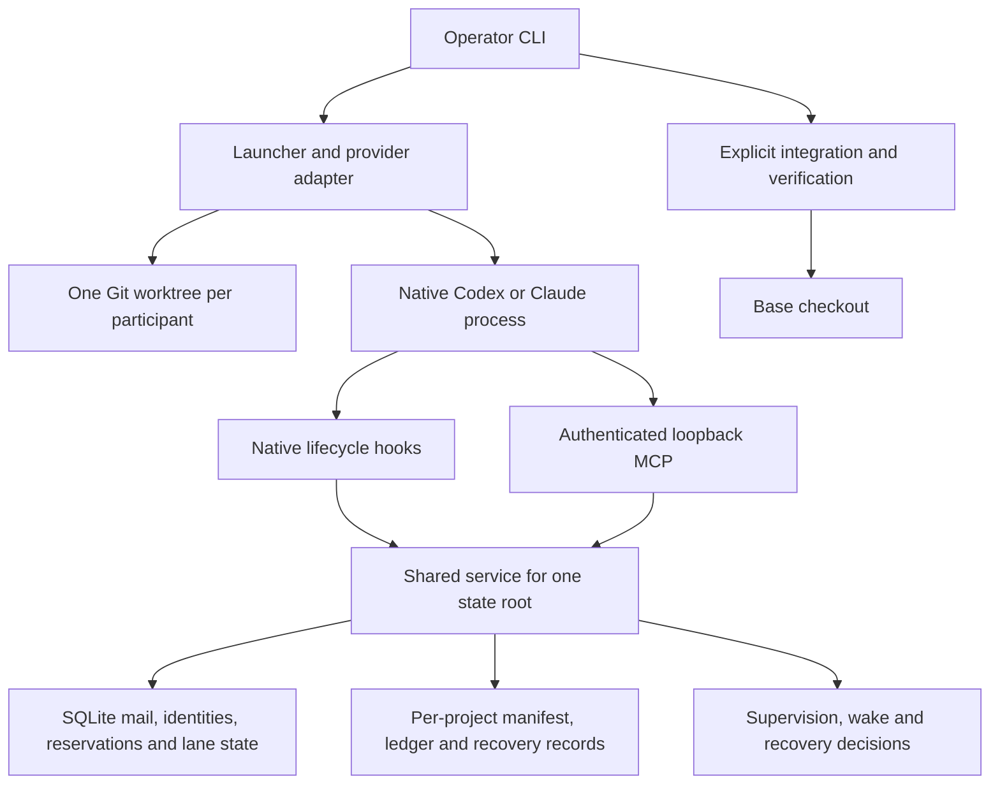

# Linux fork audit and customization baseline

Date: 2026-10-10. Scope: the local fork, its installed runtime, relevant native
client settings, and read-only GitHub repository settings. Initial supported
pair: **Codex and Claude Code**, as selected by the operator.

This is a configuration and isolation audit, not a claim that every native
client or every possible interaction has been verified. Production behavior,
global configuration, running lanes, and remote repository settings were not
changed. The accompanying inventory records the configuration surface of the
audited source, including commands that must not be run merely to inspect it.

## Assessment

The fork is a usable upstream baseline, but it is not yet an independently
configured daily distribution. Its strongest boundary is coordination within
one Git repository. It does not provide filesystem isolation from the user's
home, host-wide resource arbitration, or an independent development channel.

The first customization should establish a separate development installation,
state root, service port, and plugin provenance, then prove the Codex and Claude
Code launch paths preserve existing native configuration and project work.
Host resource coordination should follow before using several heavy projects
at once. Additional adapters come after those foundations.

## Evidence and installation identity

| Surface | Observed state |
| --- | --- |
| Checkout | `/mnt/data/Projects_SSD/agent-parley`, initially clean, `main` |
| Commit | `6a4d0572c2544023fe6a50e439b953b2915187e2` |
| Package version | `0.18.0` |
| Origin | `andreathar/agent-parley` |
| Upstream | `suneel944/agent-parley` |
| Remote comparison | Live upstream `main`, fork `main`, and checkout matched |
| Installed command | `~/.local/bin/agent-parley`, a uv tool entrypoint |
| Installed source | `~/.local/share/uv/tools/agent-parley/lib/python3.14/site-packages/agent_parley` |
| Installation provenance | uv receipt requests the package by name; no editable source URL found |
| Source comparison | All 70 top-level Python modules matched the installed copy byte for byte |
| State root | `~/.local/state/agent-parley`, mode `0700` |
| Service | PID `3297457`, authenticated readiness answered, version `0.18.0` |
| Listener | `127.0.0.1:8876`, owned by the recorded Python process |
| Protocol/store | Protocol `1`, SQLite schema `12`, doctor reports consistent |
| Test interpreter | Gate created the project environment with Python `3.14.7` |
| Development helper | RTK was not available on PATH |

Editing this checkout does not update the installed command. Matching source
today does not imply that future changes will be served by the current process.
An editable installation would create the opposite risk: source changes under
a running service. Keep those two states distinguishable in diagnostics.

The machine runs Pop!_OS 24.04 LTS with 16 logical CPUs, approximately 31.1 GiB
RAM, and an NVIDIA RTX 3060 Laptop GPU with 6 GiB VRAM. The repository and the
current state root are on different filesystems. At the reading, the repository
filesystem had approximately 560.6 GiB free and the state filesystem 121.7 GiB.
Parley worktrees and their generated dependencies consume the state filesystem.
These capacities and process identifiers are observations, not durable settings.

## Existing work that must be preserved

Only `Movies_Projects` was registered in the inspected state root. Its Codex
and Claude processes existed and their working directories matched their
recorded lane directories. Operator status reported both lanes as idle and no
open claims. Existing records include native hook activity; this audit did not
send either model a new task or verify a new model response.

The fork checkout itself is not a registered Parley project. The read-only
participant and issue listings correctly refused that scope. No setup command
was run against this checkout or another real project.

The existing Movies project has these explicit settings:

| Setting | Persisted value |
| --- | --- |
| `branch_prefix` | `parley` |
| `verify` | Empty: no Parley merge verification command |
| `initialize` | Python 3.11.9 creates a lane `.venv` with `--without-pip` |
| `forge` | `github` |
| `resources`, `approval` | Empty lists |
| `deadlines`, `budget`, `pull_request`, `integration`, `supervision` | Empty objects |
| Credential bindings | Both lanes use the native default account |
| Optional policies | No pool, run budget, integration base, timeout override, or blueprint recorded |

Python 3.11 in that initialization command is a target project's environment,
not Parley's runtime interpreter; it is not itself a violation of Parley's
Python 3.12+ requirement. Do not replace it from a generic machine profile.

The forge reading was unavailable. That observation does not establish an
authentication failure. Doctor also reported that unattended Claude resume
lacks its explicit bridge-tool approval opt-in. That is an operator choice,
not a reason to automatically enable native auto mode.

## How the system fits together

The common Git directory determines the project key, so linked worktrees of
one repository share coordination. Different clones receive different project
keys even if their remote URL is identical. The launcher pins its own CLI
prefix, creates a participant credential, injects native hooks and MCP settings,
and starts the native client. Authentication and model selection stay native.

SQLite and operation locks protect coordination transactions. Advisory file
reservations are not filesystem locks. Git worktrees share Git metadata,
branches, hooks, and the stash stack. Native processes still run as the same
Linux user and inherit the launching environment.

Relevant implementation boundaries:

- [core.py](../../agent_parley/core.py): state root, service, repository identity.
- [launch.py](../../agent_parley/launch.py): native processes and injected settings.
- [roster.py](../../agent_parley/roster.py): manifests, providers and accounts.
- [settings.py](../../agent_parley/settings.py): project configuration commands.
- [store.py](../../agent_parley/store.py): authenticated, project-scoped state.
- [supervision.py](../../agent_parley/supervision.py): defaults and background work.
- [worktrees.py](../../agent_parley/worktrees.py): setup, initialization and gates.
- [plugins.py](../../agent_parley/plugins.py): native marketplace installation.

## Findings that affect customization

### F1. The development fork shares the production namespace

The default state root and port are the same for every copy of the command.
`make install` replaces the user-level uv tool; `make install-dev` installs an
editable version under that same tool name. Neither target establishes a
separate development distribution. A new state home alone is insufficient:
its default port would still be `8876`, which the current service occupies.

`--home` selects the state directory before `AGENT_PARLEY_HOME`; otherwise the
default is `~/.local/state/agent-parley`. `AGENT_PARLEY_PORT` is read only when
`config.json` is first created. Setting it later does not override the persisted
port. The code checks a new port is in `1024..65535` and refuses occupied ports.

Use a dedicated external development state root and an explicitly checked free
port, passed per invocation. Do not export a replacement `AGENT_PARLEY_HOME`
globally. Do not run either install target against the daily tool until the
development build and rollback package are reviewable.

### F2. Named resources do not coordinate different projects

The reservation conflict query filters on the actor's `project_id`. A temporary
store probe reserved `port:5432`, `gpu:0`, and `device:android-1` in project A.
A second participant in A correctly conflicted on all three. Project B then
received all three with zero conflicts.

This is consistent with the current project-scoped design, but it does not meet
the desired host-wide protection for this workstation. Add an explicit host
resource scope for ports, GPUs, device access, and expensive build slots while
keeping repository paths project-scoped. Such reservations would still be
advisory; CPU and memory enforcement require a separate process boundary.

### F3. First setup changes a dirty base checkout

`setup` and first participant creation call `preserve_pending`, which executes
`git stash push --include-untracked`. A disposable Git probe confirmed that the
tracked file reverted to its committed content and the untracked file vanished
from the working tree, with both preserved in a stash.

This protects data but can interrupt another editor or agent using the base
checkout. For the fork, prefer a read-only preflight and refusal by default,
with an explicit operator choice to stash, commit, or select a clean checkout.
Display the exact recovery reference whenever a stash is chosen.

### F4. Plugin provenance still follows upstream

`plugins.SOURCE` is `suneel944/agent-parley`. Both native marketplace records
also point upstream. The installed Claude and direct Codex plugin copies are
`0.18.0`. This session additionally exposed the curated `0.14.0` coordinate
skill; its cached files exist. Only the direct marketplace's enabled entry was
found in the inspected Codex configuration, so this is evidence of overlapping
skill guidance, not proof of duplicate running MCP servers.

Doctor reads the plugin manifests shipped with the launcher; its plugin rows
do not establish the version loaded by an already-running native conversation.
The separate marketplace listings and cache inspection supply installation
evidence, while the session's exposed skills supply a different evidence layer.

Choose a development plugin identity and provenance strategy before editing
skills. Marketplace upgrades must not silently replace fork behavior. Preserve
the MIT license and legitimate original authorship; separate fork ownership and
support endpoints from upstream provenance.

### F5. Native permissions are inherited, not restricted by Parley

The inspected global Codex configuration has `approval_policy = "never"` and
`sandbox_mode = "danger-full-access"`. Parley does not add an OS sandbox around
it. A lane can therefore have access to global files according to the native
client's existing policy. No such native setting was changed in this audit.

Codex receives `-c` MCP settings and event-specific hook arrays. Claude receives
`--mcp-config`, `--append-system-prompt`, and `--settings`. The global clients
already have unrelated hooks. Source inspection does not prove how every
installed client version combines those layers; the first live acceptance
should verify both the existing hooks and Parley hooks actually fire once.

### F6. The active project's integration protections are unset

The Movies manifest has no verification gate, recorded merge/PR approval
requirement, advisory budget, or enforced run budget. Automatic unattended
integration and self-service PRs are also unset and therefore not authorized.
Absence of the former settings is a gap to discuss for that project, not
authorization to rewrite its policy during this fork audit.

New managed code projects should start with a project-specific verification
command and explicit integration ownership. Budgets should use measured native
usage; they do not represent billing limits or hardware quotas.

### F7. GitHub fork settings differ from the copied contribution policy

Live GitHub reads found:

- The repository is a public fork of `suneel944/agent-parley`.
- Issues are disabled, although the contribution process requires local issues.
- `main` is not protected, and the ruleset listing is empty.
- Merge commits, squash merges, and rebase merges are all allowed.
- Automatic deletion of merged branches is off.
- The Actions permissions endpoint reports enabled, but the workflow listing
  contains zero registered workflows at this snapshot.
- Repository Actions secrets and variables both list zero entries.

Do not equate the Actions permission flag or checked-in YAML with active CI.
Upstream's documented branch requirements are not inherited enforcement on the
fork. The workflow files include automatic versioning and PyPI publication
under the upstream package name; release-app credentials are absent at the
repository level. Inherited or external publishing trust was not audited.

Before the first product change, establish fork-owned issues and owners, enable
and verify CI, and configure review/merge rules. Keep distribution publication
separate until its namespace and credentials are deliberately selected.
`CODEOWNERS` and Dependabot assignees still name the upstream maintainer.

### F8. A referenced instruction file is missing

`AGENTS.md` delegates shared authority to `~/.claude/CLAUDE.md`, which does not
exist. Repository `CLAUDE.md` points back to `AGENTS.md`. Make the fork's shared
development contract self-contained or reference an existing, intentional
source. Do not create global instructions merely to satisfy an inherited path.

### F9. Copilot profile sharing can remove another project's hooks

This is outside the first supported pair but was reproduced for the platform
inventory. Two synthetic projects wrote their hooks into one Copilot profile,
both using participant name `codex`. Retiring one removed both hooks and the
shared MCP entry: cleanup identifies ownership by participant name, without
project identity.

Before enabling Copilot, require a dedicated profile per lane or change
configuration and cleanup ownership to include the project. Add a regression
covering repeated participant names across projects and unrelated native hooks.
No actual Copilot configuration was modified by the probe.

### F10. Shared provider mutations do not check the lane marker

A temporary CLI probe ran `provider add` with `AGENT_PARLEY_TOKEN` present.
It exited successfully and wrote the state-root provider registry. The command
does not use the operator-only guard that some other mutations already use.
Provider overrides apply to every project sharing that state home, including
overrides of built-in provider names.

This is a missing protection against accidental cross-project configuration
changes, not an OS security escalation: the process already runs as the same
user. Classify and guard shared configuration mutations before allowing daily
lanes to customize providers. Keep necessary lane operations, such as starting
the service for hook recovery, available under their existing contracts.

## Complete configuration map

The companion [settings inventory](2026-10-10-settings.json) was extracted from
the source parser without dispatching commands. It records 150 command paths,
502 argument entries, all 19 supervision defaults, 21 distinct Parley
environment variable names including the installer, the nine provider presets,
native hook gaps, the
timeout table, blueprint fields, and 253 selected internal constants with source
locations. Repeated argument entries are intentional: their scope is the
specific command. Internal constants are not all operator-configurable settings.

### State-root settings and precedence

| Surface | Fields or selection | Scope and behavior |
| --- | --- | --- |
| State home | `--home`, `AGENT_PARLEY_HOME`, default path | One service and registry namespace; flag wins |
| `config.json` | `port`, generated bearer `token` | All projects in that home; token is private runtime authentication |
| `supervision.json` | 19 fields below | Defaults for every registered project |
| `providers.json` | `entries.NAME` | Provider definitions override same-named presets |
| `credentials.json` | `entries.NAME` | Account profiles shared across projects using that home |
| `notify.json` | Five persisted Telegram/inbound keys | Owner-only notification configuration; process environment wins |
| `server.json` | PID and kernel creation ticks | Runtime record, not a user-authored provider setting |
| SQLite and per-project files | Identities, mail, claims, events, reports, recovery | Runtime data; keep outside source trees |

An ordinary command constructs `Bridge`, which creates a missing state home
and its initial configuration. Even a command intended as a read can therefore
initialize an absent home. The already-existing daily home was checked before
using those commands here.

### Every supervision default

All durations are seconds. Global false for `wake`, `prompts`, or `reclaim`
cannot be re-enabled by a project. Other global defaults can be overridden in
the project's `supervision` object. A lane can additionally disable its wake.

| Key | Default | Purpose |
| --- | ---: | --- |
| `interval` | 30 | Supervision polling interval |
| `inactive_after` | 300 | Native activity becomes stale |
| `stalled_after` | 600 | Work progress stall interval |
| `start_deadline` | 30 | Time allowed for the first native hook |
| `completion_reminders` | 3 | Bounded completion reminders |
| `orphan_retire_after` | 3600 | Retirement threshold for proved-dead lanes |
| `claim_idle_after` | 3600 | Held-claim inactivity threshold |
| `takeover_grace` | 300 | Grace for an unanswered takeover request |
| `max_claims_per_lane` | 2 | Concurrent held-claim limit |
| `convergence_repeats` | 3 | Repeated failure signature threshold |
| `convergence_after` | 14400 | Working time without a verified milestone |
| `prompts` | true | Coordination prompting |
| `wake` | true | Eligible lane wakes |
| `reclaim` | true | Eligible worktree/state reclaim |
| `titles` | true | Terminal title updates |
| `rerun_cancelled` | true | Eligible CI rerun behavior |
| `rotate` | true | Session rotation behavior |
| `ci_rounds` | 2 | CI repair rounds |
| `fold_after` | 86400 | Finished-claim folding retention |

Duration validators accept `1..86400`; the four count controls accept
`1..100`. Empty configuration does not disable the supervisor: the above
defaults remain active. Consequently, a separate development service should
start with wakes, prompts, and reclaim deliberately controlled.

### Project manifest settings

| Key | Default / accepted shape | Practical effect |
| --- | --- | --- |
| `version` | Manifest schema `2` | Compatibility boundary |
| `root`, `base` | Base checkout and recorded commit | Repository and initial worktree base |
| `branch_prefix` | `parley` | New branches use `prefix/project-key/lane-N` |
| `integration_base` | Absent | Optional branch whose landed PRs settle claims |
| `verify` | `[]` | No merge gate unless configured; argument list, no implicit shell |
| `initialize` | `[]` | Optional per-lane setup; receives `AGENT_PARLEY_BASE` |
| `pool` | `0`, allowed `0..8` | Prepared spare worktrees; setting it starts a fill |
| `resources` | `[]`, at most 64 names | Empty allows any valid named resource; still project-scoped |
| `deadlines` | `{}` | `claim`, `offer`, `request`, `ack`, `wait`, and `attempts` |
| `budget` | `{}` | Advisory `tokens`, `calls`, `hours` |
| `run_budget` | Absent | Explicit per-project admission budget, persistent across retries |
| `forge` | Autodetected | `github`, `beads`, or `null` |
| `approval` | `[]` | Optional recorded approval for `merge`, `pr`, or both |
| `pull_request` | `{}` | Five fields listed below |
| `integration` | `{}` | Optional `unattended.target` and bounded `unattended.issues` |
| `timeouts` | Absent | Per-kind `ask: true` or a longer timeout |
| `blueprints` | Absent | Named deterministic/agent workflows |
| `blueprint_defaults` | Absent | Forge label to blueprint mapping |
| `supervision` | `{}` | Timing/behavior defaults and native dialog choices |
| `participants` | `{}` initially | Provider, account, worktree, branch and lane controls |

Deadline durations accept `1..2592000` seconds and attempt counts `1..1000`.
An omitted acknowledgement window uses 240 seconds; the self-declared wait
ceiling falls back to 3600 seconds. Optional reservation TTL accepts `30..3600`
seconds; a reservation without a TTL has no expiry. Expiration alone is not an
OS lock release and must not be described as guaranteed filesystem protection.

Budget precedence is per field: participant, then provider, then project.
Tokens and calls are integers; hours may be fractional. Limits must be positive
and at most `10^12`; CLI zero clears a limit. Advisory limits only report and
notify. An enforced run budget gates further launches, wakes and dispatches,
and requests a checkpoint/stop at a hook; it does not kill an in-flight process.
Native transcript observations can lag or be missing and are not billing data.

The five `pull_request` fields are `change_type_labels` (empty by default),
`require_label` (false), `milestone` (`match`, also `required` or `ignore`),
`body_template` (empty, maximum 20,000 bytes), and `self_service` (false).
Unattended integration accepts one valid target branch and 1..100 issue numbers;
an empty policy authorizes no unattended merge.

### Participant and account settings

A participant records `provider`, `display`, `lane`, `branch`, `credential`,
and branch `scheme`. `wake` defaults true; `paused` defaults false; `retired`
is a runtime timestamp. `budget` overrides provider/project limits. `launch`
contains timing evidence, not resource caps. At most 32 participants are
recorded per project. Provider/account binding is fixed for an existing lane.

Native choices can be recorded per participant or under project supervision:
`dialogs` maps recognized screens to exact answers; `approve_bridge_tools`
and `auto_mode` default false; `answer_questions` is absent by default and, if
set, must be printable text of at most 500 characters. These are material
automation choices, not cosmetic preferences.

A provider definition has `adapter`, `command`, `home_env`, `env`,
`require_env`, and an optional advisory `budget`. A credential profile has
`home`, `env`, and `require_env`. A selected profile overrides provider
environment values and applies its home to `home_env`; remaining native
environment and defaults are inherited. Required names must be present in the
launching environment. The CLI rejects secret-like names in persisted override
pairs; native login material belongs to the native client.

The inspected state had no custom provider or credential registry. No native
authentication files, tokens, or environment secret values were copied into
this report or the inventory.

### Provider compatibility

| Provider / adapter | Configuration path | Audit status |
| --- | --- | --- |
| Codex | `CODEX_HOME`; per-launch MCP and hook `-c` arguments | First priority; CLI `0.162.1`, existing live process and records |
| Claude Code | `CLAUDE_CONFIG_DIR`; per-launch MCP file and settings | First priority; CLI `2.1.296`, existing live process and records |
| Gemini | Native home plus a private system-settings overlay | Executable present; no new launch tested; lacks PermissionRequest hook |
| OpenCode | Copies JSON into a private config directory and plugin | Executable present; no new launch tested; lacks SessionEnd hook |
| Copilot | Writes hooks/MCP into explicit `COPILOT_HOME` profile | Executable present; shared-profile defect reproduced; defer |
| Amp | Private settings file | Executable absent; source refuses launch for missing required hooks |
| Hermes | No adapter in this version | Executable present; separate future adapter work |
| DeepSeek / Kimi | Claude adapter plus required endpoint/auth variables | Presets only; not native standalone CLI integrations |
| Grok | Codex adapter plus required endpoint/key variables | Preset only; not a native standalone CLI integration |

The OpenCode overlay reads `opencode.json`; a JSONC-only source is refused.
It does not copy every auxiliary file in the source configuration directory,
so relative plugins and other local assets need their own compatibility probe.
Gemini preserves system policy in the overlay and refuses when it disables
hooks. These findings are deferred compatibility considerations for this fork.

### Plans, blueprints and timeout policy

Plans use `[plan]`, `[dependencies]`, `[groups]`, and optional `[revisions]`.
Applying a plan authorizes its listed work for automatic dispatch; it is not
just a diagram. Revision scope defaults empty, with `max_changes = 1` and
`max_revisions = 1` when an envelope is present. Limits are 200 issues, 32
groups, 32 members per group, 10 changed edges, and 100 automatic revisions.

Blueprint node kinds are `run`, `agent`, `push`, `pull-request`, `wait-ci`,
and `report`. Common fields are `name`, `kind`, `next`, `on_failure`, and
`retries` (default zero, at most 20). `run` adds `command` and `timeout`;
`push` adds `timeout`; `agent` adds `prompt`; `report` adds `outcome` and
`message`. Command timeout defaults to 1800 seconds. There may be 50 nodes
and at most 200 visits. None is configured in the inspected project.

The timeout table marks orphan reassignment, closed-claim resolution, idle-key
release, and one CI rerun as reversible recommendations. Default waiting is
1800 seconds. Project overrides can require asking or extend to at most seven
days. Merge to the default branch, release/tag, discarded work, branch deletion,
native permissions, and unknown kinds never receive an automatic timeout.
Table membership alone does not prove every kind is wired into the supervisor;
the event-to-kind mapping is a separate implementation boundary.

### Every Parley environment variable

| Variable | Default or purpose |
| --- | --- |
| `AGENT_PARLEY_HOME` | State home, overridden by `--home` |
| `AGENT_PARLEY_PORT` | `8876`, only during initial config creation |
| `AGENT_PARLEY_SPEC` | Installer only: package name by default, or a selected wheel/spec |
| `AGENT_PARLEY_DELIVERY_SECONDS` | Poll fallback interval `20`, clamped `0.05..600` |
| `AGENT_PARLEY_NOTIFY` | Empty/off; comma-separated notification transports |
| `AGENT_PARLEY_TELEGRAM_TOKEN` | Bot credential; never print its value |
| `AGENT_PARLEY_TELEGRAM_CHAT` | Allowed/destination chat |
| `AGENT_PARLEY_TELEGRAM_API` | `https://api.telegram.org` |
| `AGENT_PARLEY_INBOUND` | Empty/off; Telegram when configured |
| `AGENT_PARLEY_INBOUND_PASSCODE` | Required for inbound access |
| `AGENT_PARLEY_SMTP_HOST` | Mail server |
| `AGENT_PARLEY_SMTP_PORT` | `465` for implicit TLS, otherwise `587` |
| `AGENT_PARLEY_SMTP_TLS` | `starttls`; also `implicit` or `none` |
| `AGENT_PARLEY_SMTP_USER` | Optional SMTP account |
| `AGENT_PARLEY_SMTP_PASSWORD` | Optional secret |
| `AGENT_PARLEY_SMTP_FROM` | Sender |
| `AGENT_PARLEY_SMTP_TO` | Comma-separated recipients |
| `AGENT_PARLEY_TOKEN` | Launcher-generated lane identity, inherited by children |
| `AGENT_PARLEY_BASE` | Base checkout supplied to setup/workflow commands |
| `AGENT_PARLEY_HOOK_PID` | Internal hook client process identity |
| `AGENT_PARLEY_SERVICE_ANSWERED` | Internal hook fallback bookkeeping |

Only the notification selector, Telegram token/chat, inbound selector, and
inbound passcode are accepted from persisted `notify.json`; environment values
take precedence. SMTP configuration uses the environment. Notifications and
inbound control were off in the inspected home. No test notification was sent.

`scripts/install.sh` installs or force-upgrades the user uv tool, then runs
native plugin installation and doctor. Selecting a fork wheel through
`AGENT_PARLEY_SPEC` does not change the hardcoded upstream plugin source.
The script avoids editing shell startup files itself, but native plugin
installation can update user-level marketplace/plugin settings.

### Repository development and distribution configuration

| File or surface | Audited contract |
| --- | --- |
| `pyproject.toml` | Python 3.12+, no runtime dependencies, package/command `agent-parley`, version 0.18.0 |
| Build backend | Hatchling with the PyPI README hook; wheel includes the native plugin bundle |
| `uv.lock` / development group | Locked development dependencies; no runtime dependency expansion |
| Ruff | Python 3.12 target, 80-character target, Google docstrings, annotations, imports and selected correctness rules |
| Mypy | Checks production and scripts; typed definitions required |
| Pytest | Test root `tests`; full gate uses xdist auto workers |
| `.pre-commit-config.yaml` | Local Ruff, format, type, repository policy and commit-message policy hooks; configuration alone does not install Git hooks |
| `Makefile` | User install, editable install, explicit root-only system install, build, full check, benchmarks and demos |
| `make demo` | Launches live native sessions; it is not the stub demo |
| `make demo-stub` | Records the disposable stub workflow |
| `.github/workflows/check.yml` | Path-dependent Linux/Python, macOS, installation and WSL checks; no fork execution was established |
| Hygiene workflows/templates | Issue/PR metadata and attribution policies; depend on enabled forge features |
| Release workflows/manifest | Automatic eligibility/versioning, explicit release dispatch, package/plugin marker agreement |
| `.github/release-history.json` | Historical release/issue evidence, not host runtime configuration |
| `CODEOWNERS`, Dependabot | Upstream owner; weekly dependency PRs, at most five per ecosystem |
| `_config.yml`, Pages workflow | Jekyll/Pages metadata and upstream site/media URLs |
| Native marketplace/plugin manifests | Upstream identity, support URLs, version 0.18.0, wire protocol 1 |
| `server.json`, `glama.json` | Upstream directory identity/maintainer; not a live MCP service definition |
| `.gitignore` | Excludes virtualenv, test/type/lint caches, package metadata, distribution output and graphify output |

Only the repository check was run. No installer, live demo, benchmark, release,
Pages deployment, hook installation, or remote mutation was invoked.

### Internal bounds and settings outside Parley

Important fixed limits include a 3-second native hook timeout, a 5-second
SQLite busy timeout, 4096-byte message bodies before attachment spill,
8192-byte tool results, 65,536-byte attachments, 1 MiB attachment storage per
lane, 2000 retained coordination events, and bounded hook context. These are
implementation constants, not settings to enlarge indiscriminately.

Native model, reasoning, authentication, proxy, tool, sandbox, and approval
settings remain with each client. Project instructions, initialization, gates,
ports, databases, and build environments must keep their project-specific
meaning. Shell startup files showed no Parley overrides in the inspected
locations. No dedicated Parley user systemd unit appeared in the unit listing;
the current service is the existing detached process. Other project services
and the Hermes gateway remain outside this audit's mutation scope.

## First customization sequence

1. **Establish fork identity and contribution controls.** Make instructions
   self-contained; use fork owners and issue tracking; verify CI before
   configuring required checks; keep release publication separately gated.
   Preserve upstream history and license. Define how upstream updates are
   reviewed and how the local version identifies a tested fork build.
2. **Create an isolated development channel.** Use an immutable development
   package, a dedicated command or explicit interpreter, external private state,
   and a checked free port. Keep daily native accounts and marketplace records
   unchanged. Prove both service identities can coexist and that updating the
   development channel leaves the daily installation unchanged.
3. **Add one read-only configuration/preflight report.** Report executable and
   plugin origins, effective scope/precedence, port ownership, missing guides,
   dirty-checkout effects, native hook capabilities, and selected account paths.
   Values containing secrets must remain redacted. Unknown compatibility should
   be explicit. Keep this independent of project registration and service start.
   Add operator checks to shared registry mutations and reject misspelled
   configuration keys instead of letting an apparent setting have no effect.
4. **Prove the Codex/Claude pair.** Start with two disposable worktrees and two
   bounded tasks. Verify real native SessionStart, PreToolUse, Stop, mailbox,
   acknowledgement, reservation conflict, handoff, restart, and verification
   behavior. Confirm unrelated hooks still fire and native approvals remain
   effective. A mock native client and a transport test are separate evidence.
5. **Protect shared machine resources.** Introduce an explicit host resource
   namespace for ports, GPU, devices, and expensive build slots. Keep path
   reservations per repository. Start with two active lanes and a conservative
   shared build allowance, then measure memory and latency before raising it.
   The GPU is not required by Parley's standard-library coordination runtime.
6. **Connect monitoring without transferring control.** Let the existing
   Gerenciador_AI consume documented JSON status or metrics from the chosen
   installation. Preserve its service/port and use separate commands for any
   authorized operator action. Display installed, configured, running, observed
   hook, and newly verified model behavior as distinct evidence levels.
7. **Expand provider support deliberately.** Address profile ownership and
   overlay compatibility before Copilot/OpenCode/Gemini. Design Hermes around
   its actual native lifecycle and permissions, not by renaming another adapter.

No production rollout is needed to review steps 1-4. A release should have an
identified wheel/source commit, plugin versions, schema compatibility result,
per-project migration plan, backup outside repositories, and an exact rollback
installation. Do not downgrade a store written by a newer schema. Coordinate a
maintenance window for the existing Movies lanes before changing their runtime.

## Validation and limits

The full repository gate was invoked as
`PYTEST_XDIST_AUTO_NUM_WORKERS=4 make check`. The worker limit preserves the full
test selection while bounding workstation load. It exited successfully:
**2798 passed, 2 skipped, 14 warnings in 437.38 seconds**. The skips are zsh and
fish completion syntax checks because those shells are not installed. Warnings
come from Python 3.14's PTY/fork behavior in multithreaded test processes; none
was suppressed. They warrant attention when maintaining process handling, but
no deadlock or test failure was observed in this run. Detailed results are
recorded in [validation](2026-10-10-validation.txt).

The isolated probes are recorded in
[boundary probe results](2026-10-10-boundary-probes.json). They used temporary
Git repositories, a temporary SQLite store, and a synthetic Copilot profile;
they did not launch native agents, send external messages, or touch live claims.

Relevant native configuration paths and the existing project manifest were
hashed before and after the audit. Runtime telemetry can legitimately change
while the existing service runs; static configuration changes must be reported
separately. The final hash comparison is included in the validation record.

Context7 was queried using both the product name and the exact upstream
repository name. It returned unrelated projects rather than an Agent Parley
library, so no unrelated documentation was substituted. Behavior findings use
the checked-out implementation, its documentation, local reproduction, native
CLI listings, and read-only GitHub API results. The upstream repository page
was also consulted for product scope. No global authentication or permission
setting was altered to perform the audit.
